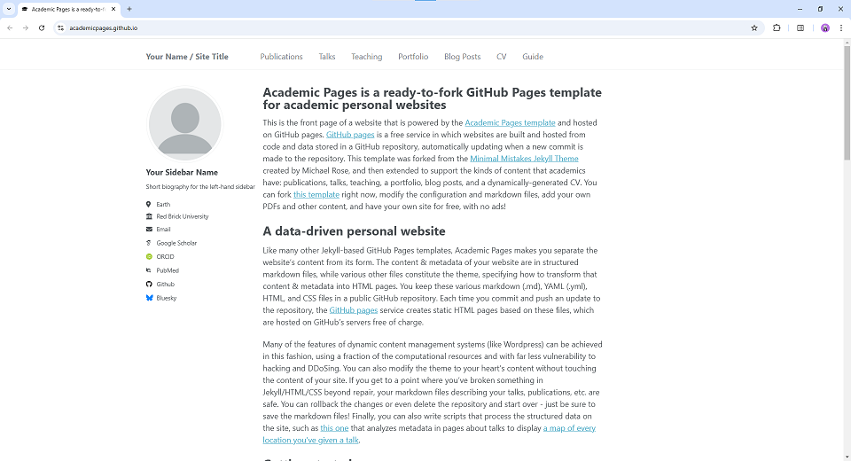

# Kairong Luo — academic website

The main pages use a lightweight Jekyll layout; the original Academic Pages documentation is retained below.

## Build and deployment

Use Ruby from `.ruby-version` and Bundler 2.6.9 for local and Cloudflare builds. Keep `Gemfile.lock` in version control so each environment installs the same dependency versions. The `github-pages` gem stays pinned to version 232, which supplies GitHub Pages-compatible Jekyll 3.10.0 and plugins; do not upgrade Jekyll independently.

```bash
gem install bundler --version 2.6.9 --no-document
bash scripts/build.sh
```

The build script installs missing locked dependencies, sets `JEKYLL_ENV=production` unless overridden, and runs `bundle exec jekyll build`. Always start Jekyll through Bundler: running bare `jekyll build` can activate Ruby's default `json` gem before the locked version is selected, causing the "already activated json" error. Do not pin JSON to a host's default version or delete the lockfile to work around this.

### Cloudflare Pages

Configure the Pages project with these settings:

| Setting | Value |
| --- | --- |
| Production branch | `master` |
| Root directory | Repository root |
| Build command | `bash scripts/build.sh` |
| Build output directory | `_site` |

The checked-in `.ruby-version` selects Ruby 3.4.4. Remove any conflicting `RUBY_VERSION` environment override, or set it to the same version, for both production and preview builds. If a previous build cached incompatible dependencies, clear the Pages build cache once and retry with the new command. No npm build is required for the checked-in site assets.

### GitHub Pages

The native GitHub Pages Jekyll build remains supported; keep the existing branch/root publishing configuration. To check its safe-mode restrictions locally:

```bash
bash scripts/build.sh --safe
```

`.github/workflows/build.yml` checks both GitHub Pages' Ruby 3.3.4 with `--safe` and Cloudflare Pages' Ruby 3.4.4 with the normal build command. These are build checks only, not additional deployment jobs. Resolve intentional dependency updates with the older Ruby version in this matrix, keep the resulting lockfile, and verify both builds before publishing.

## Content maintenance

- `_pages/about.md`: short biography and homepage structure.
- `_publications/`: canonical publication records, including `year`, `summary` (one sentence), `distinction`, and `featured_order`.
- Add `co_first_authors` and `corresponding_authors` lists using names exactly as written in `authors`; the shared author component renders `*` and `†` consistently on the homepage, publication pages, and CV. Keep citation author strings unmarked.
- `_data/cv.json`: education, honors, teaching, service, and the content-update date. Both CV routes read this file; publication lists read the collection directly. Service entries with `selected: true` also appear on the homepage, and an optional `url` links their organization.
- `_posts/`: blog metadata and future posts. Use `alternate_versions` entries with `label` and `url` to add other versions alongside the primary `article_url`; these links are preserved when importing the blog. The old template examples are unpublished.
- `assets/css/academic.css` and `_layouts/academic.html`: shared appearance and navigation.
- `images/research/FIGURE_SOURCES.md`: provenance of the research figures.

The former Markdown-to-JSON converter refuses to overwrite the data-backed CV. Conference papers and related technical reports are separate records. Honors reflect the author's updates; application forms alone are not award confirmation. Do not publish source attachments or private administrative fields.

## Puro-2B blog

The Blog navigation and homepage entry link to `/blog/prom-technical-report/`. This self-contained copy preserves the original Chinese/English article, figures, fonts, and interactive scripts. Its navigation, canonical URL, and analytics are integrated with this website. `/blog/puro-2b/` redirects to the full article.

This is a manual snapshot, not an iframe, submodule, or live connection. Editing or pushing the source repository does **not** update this website automatically; there is no sync watcher or cross-repository workflow. The importer reads the generated HTML and assets in the local source checkout, including uncommitted changes, rather than fetching a remote branch.

If article source files changed, first rebuild the blog in its own repository:

```bash
cd /root/Prom-Technical-Report
python3 blog/scripts/build.py
```

Then import the generated files and rebuild this website:

```bash
cd /root/thu-yao-01-luo.github.io
python3 scripts/import_prom_blog.py /root/Prom-Technical-Report/blog
bundle exec jekyll build
```

Review the local preview, then commit and push this website repository to publish the update. If the blog was already rebuilt, skip the first step. A local import or build alone does not update the live website.

The importer never edits the source project. It copies only the public runtime and referenced assets, not drafts, reviews, build inputs, or full font archives. It also refreshes the post's English and Chinese titles from the generated article headings, keeping the homepage, blog index, redirect page, and feed in sync while preserving the other post metadata. `_data/prom_blog_import.json` records hashes for checking the snapshot. Obsolete files from the previous import are removed only if their hashes still match; locally modified obsolete files stop the import for review. Noto and Linux Biolinum font notices are included; on another machine, pass `--noto-license` if no system notice or previously imported copy is available.

## Preview without port conflicts

```bash
bundle install
bundle exec jekyll build
python3 scripts/preview.py
```

The preview binds only to `127.0.0.1` and asks the OS for a free port, then prints the URL. It serves only `_site`, supports extensionless publication URLs, and leaves existing servers alone. Rebuild after edits and refresh the page. Nothing is pushed or deployed by these commands.

---

# Academic Pages template
**Academic Pages is a GitHub Pages template for personal and professional portfolio-oriented websites.**



# Getting Started

1. Register a GitHub account if you don't have one and confirm your e-mail (required!)
1. Click the "Use this template" button in the top right.
1. On the "New repository" page, enter your repository name as "[your GitHub username].github.io", which will also be your website's URL.
1. Set site-wide configuration and add your content.
1. Upload any files (like PDFs, .zip files, etc.) to the `files/` directory. They will appear at https://[your GitHub username].github.io/files/example.pdf.
1. Check status by going to the repository settings, in the "GitHub pages" section
1. (Optional) Use the Jupyter notebooks or python scripts in the `markdown_generator` folder to generate markdown files for publications and talks from a TSV file.

See more info at https://academicpages.github.io/

## Running locally

When you are initially working on your website, it is very useful to be able to preview the changes locally before pushing them to GitHub. To work locally you will need to:

1. Clone the repository and made updates as detailed above.
1. Make sure you have ruby-dev, bundler, and nodejs installed
    
    On most Linux distribution and [Windows Subsystem Linux](https://learn.microsoft.com/en-us/windows/wsl/about) the command is:
    ```bash
    sudo apt install ruby-dev ruby-bundler nodejs
    ```
    If you see error `Unable to locate package ruby-bundler`, `Unable to locate package nodejs `, run the following:
    ```bash
    sudo apt update && sudo apt upgrade -y
    ```
    then try run `sudo apt install ruby-dev ruby-bundler nodejs` again.

    On MacOS the commands are:
    ```bash
    brew install ruby
    brew install node
    gem install bundler
    ```
1. Use the Ruby and Bundler versions in the build instructions above, then run `bundle install` to install the locked dependencies. Keep `Gemfile.lock`; do not delete it when troubleshooting.

    If you see file permission error like `Fetching bundler-2.6.3.gem ERROR:  While executing gem (Gem::FilePermissionError) You don't have write permissions for the /var/lib/gems/3.2.0 directory.` or `Bundler::PermissionError: There was an error while trying to write to /usr/local/bin.`
    Install Gems Locally (Recommended):
    ```bash
    bundle config set --local path 'vendor/bundle'
    ```
    then try run `bundle install` again. If succeeded, you should see a folder called `vendor` and open `.gitignore` then add `vendor` inside it.

1. Run `bundle exec jekyll serve -l -H localhost` to generate the HTML and serve it from `localhost:4000`; the local server will automatically rebuild and refresh the pages on change. The `bundle exec` prefix is required to select the locked dependencies before Jekyll loads.

If you are running on Linux it may be necessary to install some additional dependencies prior to being able to run locally: `sudo apt install build-essential gcc make`

## Using Docker

Working from a different OS, or just want to avoid installing dependencies? You can use the provided `Dockerfile` to build a container that will run the site for you if you have [Docker](https://www.docker.com/) installed.

You can build and execute the container by running the following command in the repository:

```bash
docker compose up
```

You should now be able to access the website from `localhost:4000`.

# Maintenance

Bug reports and feature requests to the template should be [submitted via GitHub](https://github.com/academicpages/academicpages.github.io/issues/new/choose). For questions concerning how to style the template, please feel free to start a [new discussion on GitHub](https://github.com/academicpages/academicpages.github.io/discussions).

This repository was forked (then detached) by [Stuart Geiger](https://github.com/staeiou) from the [Minimal Mistakes Jekyll Theme](https://mmistakes.github.io/minimal-mistakes/), which is © 2016 Michael Rose and released under the MIT License (see LICENSE.md). It is currently being maintained by [Robert Zupko](https://github.com/rjzupkoii) and additional maintainers would be welcomed.

## Bugfixes and enhancements

If you have bugfixes and enhancements that you would like to submit as a pull request, you will need to [fork](https://docs.github.com/en/pull-requests/collaborating-with-pull-requests/working-with-forks/fork-a-repo) this repository as opposed to using it as a template. This will also allow you to [synchronize your copy](https://docs.github.com/en/pull-requests/collaborating-with-pull-requests/working-with-forks/syncing-a-fork) of template to your fork as well.

Unfortunately, one logistical issue with a template theme like Academic Pages that makes it a little tricky to get bug fixes and updates to the core theme. If you use this template and customize it, you will probably get merge conflicts if you attempt to synchronize. If you want to save your various .yml configuration files and markdown files, you can delete the repository and fork it again. Or you can manually patch.

---
<div align="center">
    

[](https://github.com/academicpages/academicpages.github.io/graphs/contributors)
[](https://github.com/academicpages/academicpages.github.io/releases/latest)
[](https://github.com/academicpages/academicpages.github.io/blob/master/LICENSE)

[](https://github.com/academicpages/academicpages.github.io)
[](https://github.com/academicpages/academicpages.github.io/fork)
</div>
